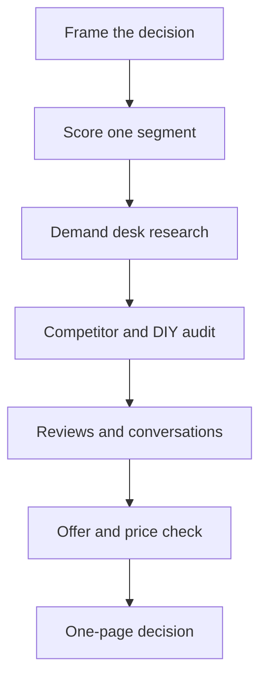

# Webstar market research outline

Saved to run later. Working playbook for Webstar Business Services: what to decide, how to run the study, and which free tools to use for Metro Detroit small-business website demand.

Sits next to [SEO.md](../SEO.md) and [client-ops/BRAND.md](client-ops/BRAND.md).

## What this research is for

Answer three decisions before changing copy, prices, or which pages you ask Google to index:

- **Who pays.** Which 2–3 Metro Detroit segments will buy a one-time site ($350–$500 Simple, higher Business / Growth tiers) versus who only fits Website as a Service ($150/mo, 6-month minimum) or a Care Plan ($49 / $99 / $179).
- **Who you beat.** Whether the real alternative is Wix/Squarespace/GoDaddy, a local freelancer, or a fuller agency — and what those buyers complain about.
- **Where to focus.** Which cities and industries have enough independent businesses with weak sites to justify a landing page, outreach, and a Google indexing request. Thin city pages that Google will not index are a research finding, not a technical bug.

Geography stays **Metro Detroit and surrounding Michigan** (Oakland, Macomb, Wayne, plus Ann Arbor where you already have a page). Do not research statewide Michigan as if you can serve it the same way.

## Best practices

- **Start with a decision, not a tool.** Write the question and the action it would change (drop a landing, change a price, pick an outreach list) before opening Trends or Maps.
- **One segment per pass.** Example: “Sterling Heights and Warren home-service trades” or “Royal Oak restaurants.” Mixing salons, dentists, and contractors in one notebook produces averages that match nobody.
- **Hypothesize first.** Before looking, write what you think they search, what they pay now, and why they have not hired anyone. Research confirms or kills that note.
- **Triangulate.** A keyword with volume, a Maps listing with a bad site, and one owner saying the same pain are stronger than any single source. One source is a clue.
- **Talk to buyers.** For a local solo offer, 8–12 short conversations beat a large survey of people who will never buy. Ask about the last time they looked for a website, what they pay now, and what would make them switch.
- **Separate demand from ability to pay.** “Web design Troy” searches do not mean a Troy shop will pay $500 this month.
- **Record date, URL, and query.** Search results and ad libraries change. A note without a source cannot be reused next quarter.
- **Do not copy competitor pages.** Use them to see offers, proof, and gaps. Your pages should answer a job Webstar actually does (3-page site, you own the files, Google setup included, ~24 hours after complete intake on Simple).
- **Stop when the decision is clear.** More tabs will not change a segment you already cannot serve or price.

## Process

### 1. Frame (half a day)

Write a one-page brief:

- Decision this round will change.
- Segment (industry + city or corridor).
- Offer you are testing (Simple, Business, Growth, WaaS, or Care).
- Hypothesis: pain, current workaround, price they accept, objection.
- Done when: you can name the winning segment or explicitly drop one.

### 2. Segment the market (half a day)

Score each candidate on five yes/no checks. Keep a segment only if most are yes.

- Many independent businesses (not chains with a national template).
- Customers find them on Google Maps or a phone search.
- Current site is missing, Facebook-only, or a slow builder template.
- Owner can pay $350–$500 once, or $150/mo for six months.
- You can show proof (a similar example, a clear package, a fast timeline).

Start with segments you already built pages for, rather than inventing new ones: trades and home services, nail and hair salons, restaurants, dentists, auto repair, cleaning, gyms, real estate, law firms, landscaping, fishing guides. Fishing guides are a national niche; score them separately from Metro Detroit local service.

### 3. Demand desk research (1–2 days)

For the chosen segment, collect:

- How people phrase the job (“website for my salon,” “Google Business Profile,” “Wix alternative,” “cheap website Michigan”) versus how agencies phrase it (“web design services”).
- Rough interest by metro Detroit vs Michigan vs United States.
- People Also Ask and autocomplete questions you can answer on one URL.
- Whether Google already shows Maps, ads, or a national builder — that tells you the click you are competing for.

### 4. Competitor and alternative audit (1 day)

Pick 5 local agencies or freelancers from Maps for “web design near me” in that city, plus Wix, Squarespace, and GoDaddy as the DIY alternative.

For each, log: offer, published price or “contact us,” turnaround, who owns the site, Google/GBP included or not, proof (reviews, local examples), and the objection their reviews mention. Note where Webstar is sharper (published ranges, ownership, GBP + Analytics + Search Console in the tier, short turnaround) and where you are thinner (few public case studies, newer domain, indexing still catching up).

### 5. Customer voice (3–5 days, can overlap)

- Read recent Google and Yelp reviews of businesses in the segment. The star rating matters less than complaints about hours, phone, booking, and “website is wrong.”
- Read 1-star and 5-star reviews of local web designers. Those are your sales objections and proof points.
- Skim local Facebook groups, Reddit (r/smallbusiness, r/Detroit), and Nextdoor threads about websites. Observe. Do not pitch.
- Book 8–12 conversations: past leads, owners whose site is only a Facebook page, and anyone who filled out contact or intake. 15 minutes. Same five questions every time: How do new customers find you? What do you use for a website today? What did the last quote cost and include? What almost stopped you? What would “done” look like in the first week?

### 6. Offer and price check (half a day)

Lay quotes and DIY costs next to your tiers. Decide, per segment:

- Simple ($350–$500) is the default, or they need booking/print (Business) or a larger build (Growth).
- Upfront price is the blocker, so lead with Website as a Service.
- They will not buy a site until Google reviews and photos exist — then the first offer is GBP setup, not a redesign.

### 7. Synthesize (half a day)

One page, no extra charts:

- Winning segment and city.
- Job to be done in their words.
- Alternative they use now.
- Offer and price to lead with.
- Proof you still need (example, review, photo).
- Pages to keep, rewrite, or stop requesting index for.
- 10-business outreach list with Maps URL and what is wrong with the current site.

### 8. Refresh monthly (1 hour)

Update the log below: queries that showed impressions in Search Console, conversations had, segments dropped, pages changed. Do not rerun the whole study.

## Free research tools

Use only tools that cost $0. A free Google Ads account is fine if you do not run ads. Skip Ahrefs, Semrush, Similarweb paid, and SparkToro paid.

- **Google Search, Maps, autocomplete, People Also Ask.** Primary tool. Incognito, set the area to the city you are studying. Count Maps results for the trade, open websites, note Facebook-only listings.
- **Google Trends.** Compare terms (web design vs Wix vs Google Business Profile) and check interest in the Detroit metro. Good for direction, weak for exact volume.
- **Google Keyword Planner.** Free inside Google Ads. Use it for relative volume and close variants in Michigan. Treat numbers as ranges, not guarantees.
- **Google Search Console and GA4.** You already have these (`G-05F8R3SKQ8`, site property on www). GSC shows which of the 58 discovered URLs earn impressions. That is market evidence: queries with impressions tell you what to deepen; URLs with none are not a reason to write another city page.
- **Google Business Profile.** Your own insights, plus competitor listing categories, photos, review count, and whether they link a real site.
- **Bing Webmaster Tools.** Free second index. Useful if you verify the site; do not expect it to replace Google.
- **Meta Ad Library.** See what local agencies and national builders are running. No account spend. Filter by country and keyword.
- **PageSpeed Insights.** Free pass/fail on a prospect’s current site. A concrete “your page is slow on a phone” note for outreach.
- **Wappalyzer (browser extension).** See if a prospect is on Wix, Squarespace, GoDaddy, or WordPress.
- **data.census.gov (American Community Survey) and County Business Patterns.** Establishment counts by county and industry (NAICS) for Oakland, Macomb, Wayne, Washtenaw. Use this for “are there enough businesses,” not for search volume.
- **BLS Quarterly Census of Employment and Wages, SBA small-business profiles.** Employment and firm-size context for Michigan. Optional; Census is enough for a first pass.
- **Yelp and Google reviews.** Customer language. Export notes manually into a sheet.
- **Reddit, public Facebook groups, Nextdoor.** Qualitative only. Small samples.
- **Google Sheets.** The research log: segment score, keyword notes, competitor rows, interview notes, final decision.

## What to put in the log

For each segment row: date, city, industry, hypothesis, Maps sample size, share with no real site, top 5 search phrases, 3 competitors with price if shown, DIY price benchmark, interview count, decision (pursue / later / drop), and the URL on webstarbusinessservices.com that should carry it.

## Guardrails for this business

- Do not add a new city or industry page because a tool showed a keyword. Add it only after the segment score and at least a few real businesses with weak sites.
- Do not let fishing-guide (national) research dilute Metro Detroit outreach. Track it as its own bet.
- Match any public claim to the locked NAP and the package that actually includes it. Research notes can be blunt; the site should stay specific.
- Indexing 58 URLs is not the research goal. The research goal is fewer, clearer offers that match how those owners already look for help.

## Research log

Fill this in when you run a pass. Leave it blank until then.

| Date | Segment | Decision | Notes |
|------|---------|----------|-------|
| | | | |
