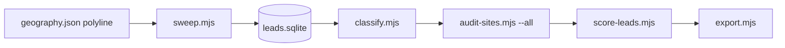

# Webstar lead generation (corridor sweep)

Find **every consumer-facing small business along a road corridor**, grade each one's website (none / F–A), and drop chains, large firms, and out-of-policy categories — using Google Places API (New) + on-site audits.

See [COMPLIANCE.md](./COMPLIANCE.md) for what we store and export, and [PILOT.md](./PILOT.md) for the runbook.

## Setup

1. Copy `.env.example` → `.env` (or add keys to repo root `.env`):
   - `GOOGLE_MAPS_API_KEY` — Places (New) + Geocoding + PSI (same key works)
   - Optional `LEAD_GEN_NEARBY_BUDGET=1000` — monthly cap on Nearby Search Enterprise calls (free tier)
   - Optional `LEAD_GEN_API_CALL_BUDGET=500` — legacy cap for the old discover/enrich flow
2. Enable **Places API (New)**, **Geocoding API**, **PageSpeed Insights API** on your GCP project; set billing alerts.
3. Edit [`config/geography.json`](config/geography.json) (corridors) and [`config/exclusions.json`](config/exclusions.json) (who to skip).

Requires **Node 20+** (uses built-in `node:sqlite`).

```bash
npm install   # from repo root (cheerio, dotenv)
```

## One command

```bash
npm run lead-gen:check                  # preflight
npm run lead-gen:sweep -- --dry-run     # tile count + call estimate, no API calls
npm run lead-gen:corridors              # sweep → classify → audit all → classify → score → export
```

Output: `exports/<cell-id>-businesses.csv` (e.g. `exports/waterford-dixie-hwy-businesses.csv`).

## Pipeline



| Step | Script | Google calls | What it does |
| --- | --- | --- | --- |
| Sweep | `sweep.mjs --cell <id>` | Nearby Search Enterprise (1 per tile) | Tiles the road polyline with circles (r 480 m, step 500 m), no type filter, `rankPreference: DISTANCE`. A tile returning 20 results is split into 4 smaller circles (down to 100 m). Keeps places within `bufferMeters` of the road with lat/lng, website, types, rating count. Resumable; stops at the monthly budget. |
| Classify | `classify.mjs [--show]` | none | Sets `exclude_reason`: `non_business`, `excluded_type` (medical, law, finance, B2B, dealers, lodging…), `chain_domain`, `chain_name`, `locator_url`, `multi_location_domain`, `large_firm`, `outside_corridor`. Manual `exclude_override` (`keep` / `exclude`) wins. |
| Audit | `audit-sites.mjs --all --skip-psi [--cell id]` | none (PSI optional) | Fetches every retained website once; HTML heuristics → `audit_flags`. `--stale-days 90` re-audits old ones. |
| Score | `score-leads.mjs` | none | `lead_score` from weights in `scoring.json`. |
| Export | `export.mjs [--out f] [--qualified-only] [--include-excluded]` | none | All retained businesses with `website_need`, `website_grade` (none/F/D/C/B/A), `website_score`, pain summary, distance to road. Densest corridor first; within a corridor worst web presence first, then along the road. |

### Adding a corridor

1. Trace the road centerline (we used OpenStreetMap / Overpass) and add a cell with `polyline: [[lat,lng],…]`, `bufferMeters` (400 = both sides of the road), `enabled: true`.
2. `npm run lead-gen:sweep -- --cell <id> --dry-run` to see the tile count, then run without `--dry-run`.
3. If the sweep stops on budget, run it again next month — it continues from pending tiles. To dig deeper into saturated spots later: `--deepen --max-depth 4`.

Cells with only `center` / `radiusMeters` still work with the legacy type-based `discover.mjs` / `enrich.mjs` flow (`npm run lead-gen:pilot`).

## Admin map

Logged-in **admin** accounts can open the corridor on the local site:

`http://localhost/webstar-business-solutions/portal/leads-map.php`

or **Lead map** from the Client Portal projects page. Pins are retained businesses coloured by website grade; filters default to high/medium need. Tiles are free OpenStreetMap (Leaflet). Coordinates older than 30 days are omitted until you re-sweep.

## Data

SQLite database: `lead-gen/data/leads.sqlite` (gitignored). Tables: `leads`, `sweep_tiles`, `meta`.

Useful manual overrides (sqlite3 or Node):

```sql
UPDATE leads SET exclude_override = 'keep'    WHERE place_id = '...';  -- force into the list
UPDATE leads SET exclude_override = 'exclude' WHERE place_id = '...';  -- force out
```

Then re-run `npm run lead-gen:classify` and `npm run lead-gen:export`.
